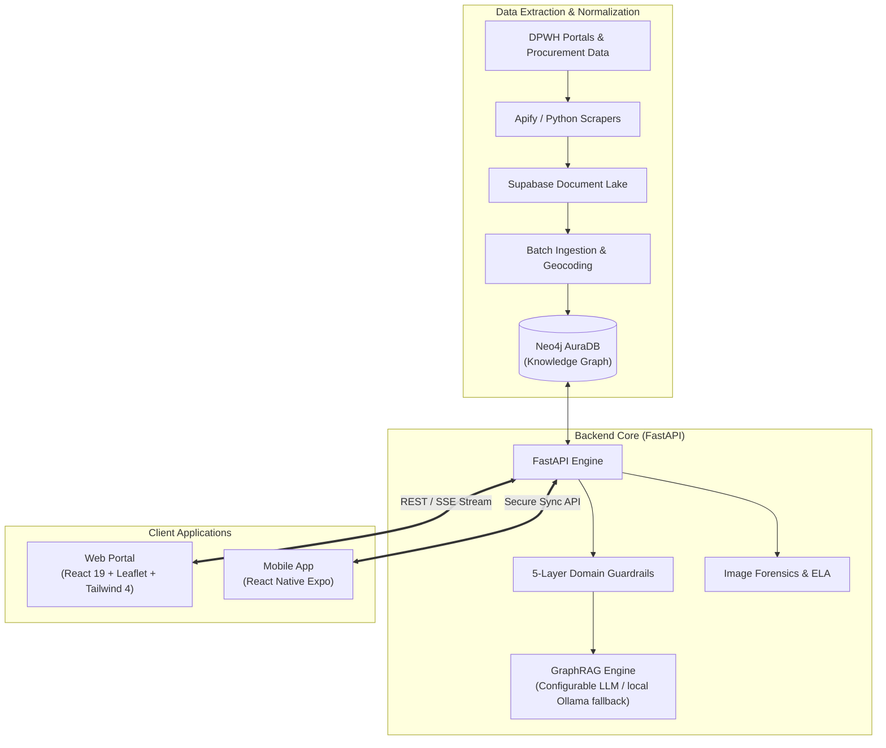

# ProjectTrack

> **Civic Intelligence and Transparency Engine for DPWH Infrastructure Projects Across Cebu**  
> *Transforming fragmented public civil works data into verifiable, geospatial, and graph-powered community intelligence.*

[](LICENSE)
[](#)
[](https://python.org)
[](https://fastapi.tiangolo.com)
[](https://react.dev)
[](https://vite.dev)
[](https://neo4j.com)
[](https://leafletjs.com)

---

## Executive Summary (2-Minute Read)

Every fiscal year, billions of Philippine Pesos are allocated for Department of Public Works and Highways (DPWH) civil works projects across the country. Citizens, watchdog organizations, journalists, and local governments routinely encounter structural transparency barriers:

* **Opaque Project Statuses**: Difficulty in independently verifying execution progress and tracking completion timelines.
* **Information Fragmentation**: Procurement notices, allocation records, and contractor track records reside in separate, non-relational databases.
* **Absence of Ground-Truth Validation**: Vulnerability to off-site photo submissions and lack of mandatory physical proximity checks during on-site documentation.

**ProjectTrack** addresses these systemic challenges for the Province of Cebu across all **53 Local Government Units (LGUs)** (44 municipalities and 9 cities). By combining automated web scraping, Neo4j knowledge graphs, tamper-evident image forensics, geofenced mobile verification, and a domain-guarded GraphRAG assistant, ProjectTrack converts raw public disclosures into structured, accessible civic intelligence.

---

## System Features

### Web Platform (`Website`)
* **Interactive Cebu Geospatial Map**: Renders vector boundaries for all 53 LGUs down to barangay levels without relying on heavy satellite tile streaming, displaying status-coded markers. Overlapping projects are grouped by zoom-aware proximity clustering, and the map stays synchronized with the chat - flying to a selected LGU or zooming to and highlighting a single project for superlative/locating questions.
* **GraphRAG-Powered AI Assistant**: Contextual natural language query engine grounded in the Neo4j knowledge graph, with domain guardrails and a configurable LLM provider (Groq by default). Supports conversational memory for follow-ups ("tell me more about it", "what about in Cordova?") via a sandboxed, whitelist-validated reference resolver that stays strictly database-locked and injection-safe.
* **Image Forensics Verification**: Built-in Error Level Analysis (ELA) and cryptographic metadata inspection to detect digital manipulation, timestamp tampering, or image recycling.
* **Budget and Expenditure Transparency**: Real-time auditing of allocated funds, expenditure disbursements, variance indicators, and source funding across municipalities.
* **Automated Data Aggregation**: Continuous extraction and normalization of DPWH civil works registries and PhilGEPS procurement bulletins into a unified data store.

### Planned Mobile Field Auditor (`mobile` — React Native with Expo)
* **Geofenced On-Site Photo Capture**: Planned use of React Native and Expo (`expo-location`, `expo-camera`) to verify GPS proximity to project coordinates before photo capture.
* **Offline-First Background Sync**: Planned offline caching and background synchronization for field observations in low-connectivity areas.

### Core Backend and Services (`backend`)
* **Personnel and Entity Graph Mapping**: Models relationships between contractors, authorized managing officers, district engineers, and procurement awards into a traversable graph.
* **Spatial Data Integrity**: Exact, canonicalized municipality matching eliminates cross-LGU leakage, and a polygon reverse-geocoding pipeline reassigns each project to the LGU that actually contains its authentic DPWH coordinates (projects outside Cebu are flagged and excluded).
* **High-Throughput RESTful and SSE API**: Production-grade FastAPI endpoints supporting sub-20ms instant Cypher queries, Server-Sent Events (SSE) streaming, and standardized GeoJSON feeds.

---

## System Architecture



---

## Quick Start Guide

### 1. Prerequisites
* Python 3.10 or higher
* Node.js 18 or higher with npm
* Git

### 2. Backend Setup
```bash
# Navigate to backend directory
cd backend

# Create and activate virtual environment
python -m venv venv
# Windows: .\venv\Scripts\Activate.ps1 | Linux/macOS: source venv/bin/activate

# Install dependencies
pip install -r requirements.txt

# Configure environment variables
cp .env.example .env

# Start FastAPI application
python -m uvicorn backend.main:create_app --factory --reload --port 8000
```
The REST API will be accessible at `http://localhost:8000` (Interactive documentation at `http://localhost:8000/docs`).

### 3. Website Setup
```bash
# Open a new terminal and navigate to Website directory
cd Website

# Install frontend dependencies
npm install

# Start development server
npm run dev
```
The web dashboard will be available at `http://localhost:5173`.

---

## Documentation Hub

Comprehensive architectural, technical, and operational documentation is maintained in the [`docs/`](docs/) directory:

| Document | Description |
| :--- | :--- |
| [**01. Getting Started**](docs/01-getting-started.md) | Setup walkthrough, 3-minute guided evaluation tour, and verification steps. |
| [**02. Architecture & Pipelines**](docs/02-architecture.md) | System topology, GraphRAG data pipeline, guardrail mechanics, and forensic verification. |
| [**03. Tech Stack Justification**](docs/03-tech-stack.md) | Engineering justifications for Neo4j, FastAPI, React 19, Leaflet, and MiMo. |
| [**04. Comprehensive Setup Guide**](docs/04-setup-guide.md) | Production provisioning, Neo4j Aura cloud configuration, and deployment topology. |
| [**05. API Reference**](docs/05-api-reference.md) | Endpoint specifications, JSON request/response contracts, and SSE streaming schemas. |
| [**06. Development Roadmap**](docs/06-roadmap.md) | Phased milestones, barangay polygon rendering, and community initiative integration. |
| [**07. Security Architecture**](docs/07-security.md) | Threat modeling, 5-layer domain guardrails, digital forensics, and privacy protection. |

---

## Repository Structure

```text
ProjectTrack/
├── README.md                            <-- Landing Page & Pitch (Current Document)
├── CONTRIBUTING.md                      <-- Contribution workflow and coding standards
├── CODE_OF_CONDUCT.md                   <-- Contributor Covenant community standards
├── SECURITY.md                          <-- Vulnerability reporting and threat policy
├── LICENSE                              <-- MIT Open-Source License
├── .github/                             <-- GitHub issue and pull request templates
├── docs/                                <-- Central technical documentation
│   ├── 01-getting-started.md
│   ├── 02-architecture.md
│   ├── 03-tech-stack.md
│   ├── 04-setup-guide.md
│   ├── 05-api-reference.md
│   ├── 06-roadmap.md
│   └── 07-security.md
├── Website/                             <-- React 19 + Leaflet geospatial web platform
├── mobile/                              <-- Planned React Native Expo field auditor app
└── backend/                             <-- FastAPI, Neo4j GraphRAG, and scraping pipeline
```

---

## Open-Source Community and Governance

ProjectTrack is maintained under an open-source model to advance civic technology, data transparency, and public accountability.

* **Contributing**: Review [CONTRIBUTING.md](CONTRIBUTING.md) for pull request workflows and development guidelines.
* **Code of Conduct**: Adherence to the [CODE_OF_CONDUCT.md](CODE_OF_CONDUCT.md) is expected across all project channels.
* **Security & Responsible Disclosure**: Read [SECURITY.md](SECURITY.md) before reporting vulnerabilities.
* **Issue Tracking**: Report technical defects or submit architectural proposals through our [GitHub Issue Templates](.github/ISSUE_TEMPLATE/).

---

## License

This project is licensed under the **MIT License**. Refer to the [LICENSE](LICENSE) file for complete terms and copyright notices.
