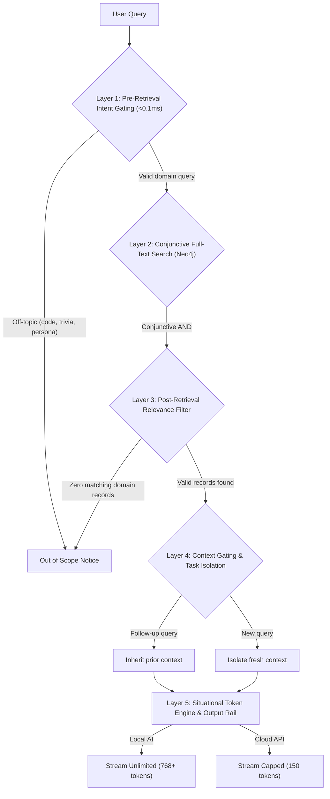

# DPWH Cebu Infrastructure Knowledge Graph and QA System

An end-to-end GraphRAG pipeline for scraping, ingesting, analyzing, and querying **4,370+ DPWH civil works projects** across Cebu Province (2022 – Present).

Built with **Neo4j Aura (Knowledge Graph)**, **Supabase (Document Lake)**, **Apify (Web Scraper)**, and **Xiaomi MiMo (`XiaomiMiMo/MiMo-V2-Flash`)** for low-latency grounded question answering with multi-layer domain guardrails.

---

## Key Features

* **Sub-20ms Graph Traversal**: Direct Cypher queries and full-text index lookups across 4,370+ DPWH projects, contractors, budgets, and locations in Cebu.
* **5-Layer Domain Guardrails**: Domain lock that intercepts programming questions, generic dictionary definitions, persona overrides (`act as a teacher`), and off-topic queries in `<0.1ms` before hitting Neo4j or the LLM.
* **Situational Token Engine**:
  * **Local AI (Ollama)**: Automatically detected via `localhost`. Runs with full output context and zero external billing.
  * **Cloud APIs (Xiaomi MiMo / OpenAI / Hugging Face)**: Configurable token budget caps (`LLM_MAX_TOKENS`) to preserve inference limits.
* **Instant Cypher Mode (Zero AI Needed)**: Instant lookup cards, analytics, and full-text search run purely on Neo4j Aura in `<10ms` without requiring external LLM API calls.
* **Conversational Memory**: Context-aware follow-up handling across multiple query turns.
* **Instant Graph Analytics**: Sub-millisecond aggregation calculates total budgets, contractor rankings, and project counts directly from graph relationships.

---

## Repository Structure

```text
backend/
├── backend/                    # FastAPI REST & SSE Streaming Backend
│   ├── main.py                 # FastAPI application, CORS, lifespan & error handlers
│   ├── run.py                  # Server runner CLI (python backend/run.py)
│   ├── config.py               # Pydantic Settings configuration
│   ├── api/                    # Modular routes (projects, analytics, chat, pipeline, health)
│   ├── models/                 # Pydantic data schemas
│   ├── services/               # Neo4j, LLM, Guardrails, and Pipeline services
│   └── tests/                  # Unit and integration test suite
├── main.py                     # Master CLI runner (interactive console, batch analytics, --api)
├── pipeline/                   # Core modular pipeline package
│   ├── __init__.py             # Unified package exports
│   ├── scrape_cebu_dpwh.py     # BetterGov scraper -> Apify & Supabase
│   ├── sync_to_neo4j.py        # Paginated batch ingestion -> Neo4j Aura
│   └── query_graph.py          # Cypher queries, Guardrails & LLM reasoning
├── .env.example                # Template for required environment variables
├── requirements.txt            # Python dependencies (includes FastAPI, Uvicorn)
└── README.md                   # Installation, usage & architecture guide
```

---

## Prerequisites

1. **Python 3.10+** (Tested on Python 3.10, 3.11, 3.12)
2. **Git**
3. **Neo4j AuraDB** (Free cloud graph database instance or local Neo4j Bolt)
4. **Supabase** (Optional: only needed if synchronizing raw document lake records)
5. **Apify** (Optional: only needed if executing the web crawler)

---

## Step-by-Step Installation

### Step 1: Navigate to Backend
```bash
cd backend
```

### Step 2: Create and Activate Virtual Environment

**Windows (PowerShell):**
```powershell
python -m venv venv
.\venv\Scripts\Activate.ps1
```

**Linux / macOS:**
```bash
python3 -m venv venv
source venv/bin/activate
```

---

### Step 3: Install Dependencies
```bash
pip install -r requirements.txt
```

---

### Step 4: Configure Environment Variables

Copy the template environment file:

**Windows (PowerShell):**
```powershell
Copy-Item .env.example .env
```

**Linux / macOS:**
```bash
cp .env.example .env
```

Review and update `.env`:

```dotenv
# Neo4j Graph Database
NEO4J_URI="neo4j+s://your-instance.databases.neo4j.io"
NEO4J_USERNAME="neo4j"
NEO4J_PASSWORD="your_neo4j_password"

# Xiaomi MiMo-V2-Flash Configuration
LLM_BASE_URL="https://router.huggingface.co/v1"
LLM_MODEL="XiaomiMiMo/MiMo-V2-Flash"
LLM_API_KEY="hf_your_free_token"
LLM_MAX_TOKENS="2048"

# Apify & Supabase (Optional)
APIFY_TOKEN="your_apify_api_token"
SUPABASE_URL="https://your-project-id.supabase.co"
SUPABASE_SERVICE_KEY="your_supabase_service_role_key"
```

---

## Execution Modes

### 1. Interactive Console (Default Mode)
```powershell
python main.py
```
Connects to Neo4j Aura and launches the interactive query environment:
```text
Neo4j Knowledge Graph Console (DPWH Cebu Infrastructure)
=================================================================
Commands:
  Type any project ID (e.g. '24HH0043') for instant project card (<10ms)
  Type '/search <term>' or '/fts <term>' for full-text search (<20ms)
  Type '/top-contractors' to see top contractors by awarded budget
  Type '/top-budgets' to see the largest projects
  Type '/summary' for dataset totals
  Type '/instant' for sub-second database mode (skips LLM wait)
  Type '/ai' for grounded AI streaming summary mode
  Type '/clear' to reset conversation memory
  Type 'exit' to quit
=================================================================
```

---

### 2. Direct Command-Line Lookups
```powershell
# Instant project card (<10ms lookup directly from graph)
python main.py 24HH0043

# Natural language query
python main.py "any projects in bogo?"

# Sub-second instant mode (pure Neo4j, skips AI summaries)
python main.py --instant
```

---

### 3. Analytics and Graph Insights
```powershell
# Top 10 Contractors by Total Awarded Budget
python main.py --top-contractors

# Top 10 Largest Infrastructure Projects by Budget
python main.py --top-budgets

# Overall Dataset Summary
python main.py --summary
```

---

### 4. Data Scraping and Neo4j Ingestion
```powershell
# Ingest Supabase projects into Neo4j Aura
python main.py --sync

# Scrape projects from BetterGov into Apify & Supabase
python main.py --scrape

# Run full pipeline: Scrape -> Sync -> Open Console
python main.py --all
```

---

### 5. Launch FastAPI Backend Server (REST & SSE Streaming)
```powershell
# Option A: From backend root using master runner
python main.py --api

# Option B: Using backend runner
python backend/run.py

# Option C: Using Uvicorn directly
python -m uvicorn backend.main:create_app --factory --reload --port 8000
```

* **Interactive Swagger UI**: `http://localhost:8000/docs`
* **ReDoc Documentation**: `http://localhost:8000/redoc`

---

## Domain Guardrail Architecture

The system implements defensive layers to isolate legitimate infrastructure inquiries from off-topic requests:



### Supported vs. Blocked Queries

| Query Type | Example | Result |
| :--- | :--- | :--- |
| **Project ID** | `24HH0043`, `25H00064` | Instant Project Card (<10ms) |
| **Location Query** | `any projects in Bogo?`, `schools in Carcar` | Verified project list and insights |
| **Scope / Topic** | `what is flood control?`, `asphalt overlay` | Grounded DPWH engineering synthesis |
| **Contractor Inquiry** | `who is WTG Construction?`, `top contractors` | Total budget and project statistics |
| **Programming Request** | `what is the code for for loops?`, `python script` | Blocked (<0.1ms) |
| **Generic Definition** | `what is dictionary?`, `what is science?` | Blocked (<0.1ms) |
| **Persona / Jailbreak** | `act as a teacher`, `ignore previous instructions` | Blocked (<0.1ms) |
| **Conversational Trivia** | `tell me a joke`, `recipe for adobo` | Blocked (<0.1ms) |

---

## Troubleshooting

| Issue | Solution |
| :--- | :--- |
| **Missing Neo4j credentials** | Verify that `.env` includes valid `NEO4J_URI` and `NEO4J_PASSWORD` values. |
| **Local Ollama is offline** | Start the Ollama daemon via `ollama serve`, or run in instant mode (`python main.py --instant`). |
| **AuraDB paused due to inactivity** | Free-tier AuraDB instances pause after periods of inactivity. Resume the instance via the [Neo4j Aura Console](https://console.neo4j.io/). |
| **Console character encoding error** | Start Python with the UTF-8 flag: `python -X utf8 main.py`. |

---

## License

This project is licensed under the MIT License.
