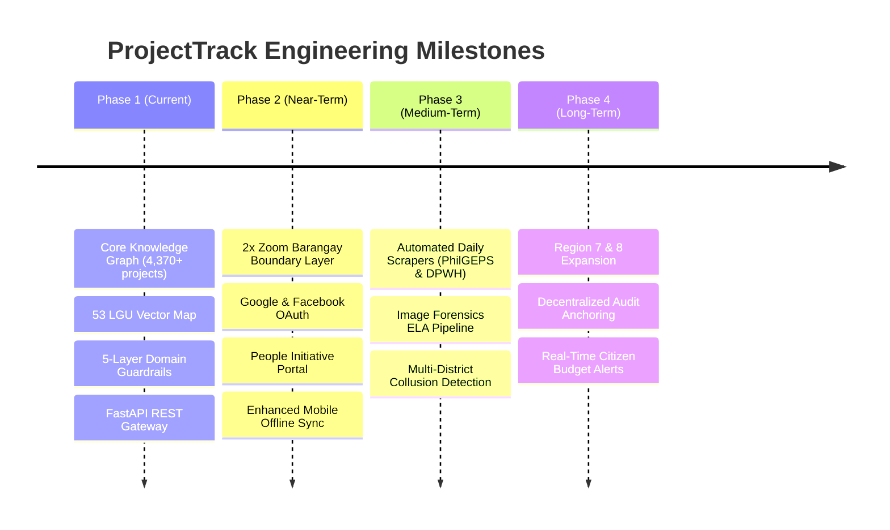
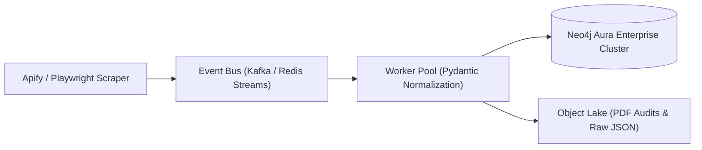

# 06. Development Roadmap and Scalability Vision

This document details the phased release schedule, active engineering priorities, and long-term architectural scalability roadmap for the ProjectTrack platform.

---

## 1. Release Timeline Overview

---

## 2. Active Development Priorities

### 2.1 High-Priority Milestones

#### 2x Zoom Barangay Boundary and Density Layer
* **Objective**: Enable dynamic vector layer switching to display all constituent barangays (1,066+ administrative subdivisions across Cebu) when zooming beyond level 12.
* **Technical Constraints**: Optimize GeoJSON simplification tolerances and quadtree spatial indexes to ensure 60fps panning performance on low-spec client hardware.
* **Status**: In Progress (`Website/src/features/map`).

#### GraphRAG Grounding and Secure Endpoints
* **Objective**: Finalize parametric Cypher query templates and rate limiting on `/api/chat` and `/api/chat/stream`.
* **Technical Constraints**: Implement Redis-backed token bucket rate limits to protect free-tier LLM inference endpoints from denial-of-service attempts.
* **Status**: Core engine operational; rate-limiting middleware scheduled.

---

### 2.2 Medium-Priority Milestones

#### Citizen Authentication (OAuth 2.0 / OIDC)
* **Objective**: Allow community monitors and local watchdogs to establish verified accounts via Google and Facebook OAuth.
* **Scope**: JWT-based session tokens, role-based access control (`Citizen`, `Auditor`, `Data Journalist`, `Administrator`).

#### People's Initiative and Community Feedback Engine
* **Objective**: Provide an authenticated participatory module where residents can:
  * Upvote or express community need for proposed civil works (e.g. road widening, drainage).
  * Report stalled, abandoned, or defective infrastructure directly linked to an official DPWH project ID.
  * Upload geotagged verification photos.

#### Unified District and Municipal Pin Interaction
* **Objective**: Standardize click interactions across administrative levels. Clicking a municipal boundary or district engineering office (DEO) triggers a slide-out panel detailing all concurrent projects, total allocated budget, and contractor distribution.

---

## 3. Future Scalability and Architectural Vision

### 3.1 Scaling Knowledge Graph Ingestion
As project volume expands from Cebu Province (4,370+ records) to Region 7 (Central Visayas: Bohol, Negros Oriental, Siquijor) and nationwide DPWH registries (100,000+ records), the data pipeline will transition from batch scripts to distributed event-driven ingestion:

### 3.2 Advanced Anti-Collusion Graph Analytics
Leverage Neo4j Graph Data Science (GDS) algorithms to compute:
* **Contractor Centrality & Clustering**: Detect circular joint-venture bidding patterns where specific contractors repeatedly bid in paired configurations across districts.
* **Variance Anomalies**: Flag projects with statistically significant completion time variances or repeat budget augmentations exceeding the 10% statutory threshold.

### 3.3 Cryptographic Audit Trail
To protect civic reports against retrospective tampering or censorship:
* Generate an immutable SHA-256 Merkle root of verified on-site field audits every 24 hours.
* Anchor the Merkle root onto an open public ledger or timestamp authority, guaranteeing historical immutability for investigative journalists and public watchdogs.

### 3.4 Mobile Application Rollout
* Complete the production build of the React Native Expo client using EAS (Expo Application Services) with `expo-camera`, `expo-location` hardware hooks, and `expo-task-manager` for resilient offline background synchronization.
