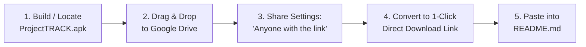
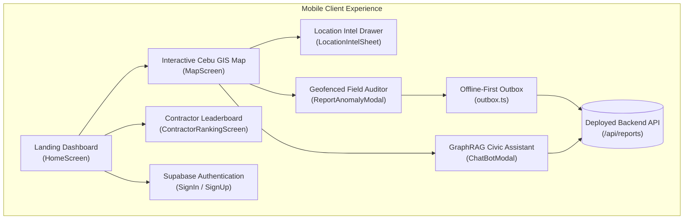

# ProjectTrack Mobile Client

> **Autonomous Civic Intelligence & Geofenced Field Auditor for DPWH Infrastructure Verification Across Cebu Province**

[](https://expo.dev)
[](https://reactnative.dev)
[](https://typescriptlang.org)
[](scripts/build-apk.bat)
[](../LICENSE)

---

## ⚡ 1-Click App Download (Google Drive & Zero-Setup Install)

*Assuming the ProjectTRACK cloud backend is live and deployed, any evaluator, tester, or citizen can download and install the mobile app in just 1 click:*

### 📥 Option A: 1-Click Direct Download (From Google Drive)

[-0d9488?style=for-the-badge&logo=google-drive&logoColor=white)](https://drive.google.com/uc?export=download&id=YOUR_GDRIVE_FILE_ID)

> **📱 How to Install on Android in 3 Steps:**
> 1. Tap the **Download Button** above on your Android phone's browser *(downloads `ProjectTRACK.apk` directly)*.
> 2. Open the downloaded file from your notification bar or Downloads folder.
> 3. Tap **Install** *(if prompted, allow "Install unknown apps" for your browser)*. The app connects to the live backend automatically!

---

### 📦 Step-by-Step: How to Extract & Upload the APK to Your Google Drive

If you are the developer or project owner hosting the `.apk` on your own Google Drive for your users, follow these steps to extract the exact files:



#### Step 1: Extract the Specific File from Your Project
You only need **ONE** primary file for end-users to install on their phones:

| File Name | Location in Project | Purpose |
| :--- | :--- | :--- |
| **`ProjectTRACK.apk`** | `mobile/dist/ProjectTRACK.apk` *(Cloud EAS)*<br>OR `mobile/android/app/build/outputs/apk/release/app-release.apk` *(Local Gradle)* | The standalone Android application binary (~45–65 MB). |

* **If you build using Cloud EAS (Recommended — No Android Studio / Java needed):**
  1. Double-click [`scripts/build-apk.bat`](scripts/build-apk.bat) *(or run `npm run build:apk:cloud`)*.
  2. When the build finishes, EAS generates a download link. Download the `.apk` and place it in `mobile/dist/ProjectTRACK.apk`.
* **If you build locally with Gradle:**
  1. Run `npm run build:apk:local`.
  2. Navigate to `mobile/android/app/build/outputs/apk/release/`.
  3. Copy `app-release.apk` and rename it to `ProjectTRACK.apk`.

#### Step 2: Upload to Google Drive
1. Open your browser and go to [Google Drive](https://drive.google.com).
2. Click **+ New** → **File upload** *(or drag and drop `ProjectTRACK.apk` into your Drive)*.
3. Wait for the upload to complete.

#### Step 3: Enable Public Sharing
1. Right-click the uploaded `ProjectTRACK.apk` file in Google Drive.
2. Select **Share** → **Share**.
3. Under **General access**, change from **"Restricted"** to **"Anyone with the link"** *(Role: Viewer)*.
4. Click **Copy link**.
   - Your link will look like this:
     ```text
     https://drive.google.com/file/d/1a2b3c4d5e6f7g8h9_ExampleID/view?usp=sharing
     ```

#### Step 4: Convert to a 1-Click Instant Download Link
By default, Google Drive opens an in-browser preview page. To make it download the `.apk` **immediately in 1 click**:
1. Copy the **FILE_ID** from your link *(the part between `/d/` and `/view`)*:
   - In `https://drive.google.com/file/d/1a2b3c4d5e6f7g8h9_ExampleID/view`, the ID is:
     `1a2b3c4d5e6f7g8h9_ExampleID`
2. Construct the direct 1-click download URL using this format:
   ```text
   https://drive.google.com/uc?export=download&id=1a2b3c4d5e6f7g8h9_ExampleID
   ```
3. In [`mobile/README.md`](README.md), replace `YOUR_GDRIVE_FILE_ID` with your actual ID!

---

### 💻 Option B: 1-Click USB ADB Installer (For PC Users)
If you want to provide a 1-click installation folder for evaluators or users who have their phone plugged into a computer:

1. Create a zip file named `ProjectTRACK-USB-Installer.zip` containing these 3 files:
   - `ProjectTRACK.apk` *(the compiled binary)*
   - [`install-apk.bat`](scripts/install-apk.bat) *(Windows 1-click USB installer)*
   - [`install-apk.sh`](scripts/install-apk.sh) *(macOS/Linux 1-click USB installer)*
2. Upload `ProjectTRACK-USB-Installer.zip` to Google Drive.
3. When users extract the zip on their PC and double-click `install-apk.bat`, ADB automatically detects their connected Android phone and installs `ProjectTRACK.apk` in seconds.

---

## 📱 Complete Mobile Features Documentation

The ProjectTRACK mobile client is designed specifically for on-the-ground civic engineering verification, contractor auditing, and open data visualization across the **53 Local Government Units (LGUs)** of Cebu.



---

### 1. Interactive Cebu GIS Vector Map (`UnifiedCebuMap`)
* **53 LGU Cartography**: Full vector cartography covering all 44 municipalities, 6 component cities, and 3 Highly Urbanized Cities (Cebu City, Mandaue, Lapu-Lapu) rendered with zero dependency on proprietary tile servers.
* **3-Tier Administrative Hierarchy Bar**: Filter the view seamlessly across **All Cebu**, **Component Cities**, **HUCs**, or **Municipalities**.
* **Regional Quick-Jump Presets**: One-touch camera focal jumps to:
  - 🏙️ **Metro Cebu** (Cebu City, Mandaue, Lapu-Lapu, Talisay, Minglanilla, Consolacion, Liloan, Cordova)
  - ⚓ **Northern Cebu** (Bogo, Daanbantayan, Medellin, San Remigio, Borbon, Sogod)
  - 🌊 **Southern Cebu** (Carcar, Argao, Dalaguete, Oslob, Santander, Samboan)
  - 🏝️ **Camotes & Bantayan Islands**
* **Dynamic Density Clustering & Status Color-Coding**:
  - 🟢 **Teal Diamonds**: Ongoing civil works with progress percentages.
  - 🔵 **Blue Diamonds**: Completed civil works verified on record.
  - 🟡 **Amber Diamonds**: Delayed or stalled infrastructure.
  - 🔴 **Concentric Radar Beacons**: Red anomaly hotspots indicating projects with active citizen complaints.
* **Touchscreen-Optimized Hit-Testing**: Touch coordinates are projected through container page layout coordinates, ensuring instant and accurate municipality/pin selection without touch offset bugs.

---

### 2. Location Intelligence Sheet (`LocationIntelSheet`)
* **Persistent Bottom Drawer**: Sits at the bottom of the map in a compact, non-intrusive peek bar, expandable up to 48% screen height so the map is never smothered.
* **Aggregated LGU Metrics**: Instant calculation of total civil works, cumulative budget expenditure (in ₱ Millions/Billions), active vs completed project counts, and delayed infrastructure flags.
* **Status Filter Chips**: Filter projects on the fly by `All`, `Ongoing`, `Completed`, or `Delayed`.
* **Citizen Consensus Voting**: Upvote ("Confirm") or downvote ("Dispute") community reports on individual project cards with instant haptic feedback.
* **One-Touch Field Audit Launch**: Jump straight into the geofenced camera auditor for any selected project.

---

### 3. Geofenced Field Auditing & Anti-Fraud Engine (`ReportAnomalyModal`)
* **Mandatory Physical Proximity Gate (Pillar 1)**: The camera shutter remains **strictly locked** until the device's live hardware GPS (`expo-location`) is verified within **≤150 meters** of the official DPWH project centroid.
* **Live Camera Lens Enforcement**: Photo evidence must be captured directly through the live camera shutter (`expo-camera`). Gallery photo picking is disabled to eliminate the submission of stock photos, pre-recorded media, or internet screenshots.
* **Client-Side Payload Hardening**: User notes and descriptions are scrubbed by `sanitizer.ts`, stripping script tags, DOM event handlers, Cypher delimiters, and SQL injection patterns before reaching the network.
* **Server-Side Forensic Verification**: Reports submitted to the backend undergo dual-layer automated image forensics:
  - **Error Level Analysis (ELA)**: Detects digital manipulation, Photoshop artifacts, and spliced signage.
  - **Perceptual Hashing (pHash)**: Screens against duplicate or recycled historical photo submissions across the province.

---

### 4. Community Verification Badges (`VerificationBadges`)
Every field report displays a cryptographic and proximity verification badge:
* 🛡️ **On-Site Verified**: Device confirmed within ≤150m of project coordinates with pristine image forensic integrity.
* ⚠️ **Unverified / Off-Site**: Report submitted outside the 150m boundary or without valid GPS hardware lock.
* 🚨 **Photo Flagged**: Image forensics detected digital alteration, compression anomalies, or duplicate photo recycling.
* 📏 **Proximity Distance & Auditor Reputation**: Shows exact physical distance from site (e.g., `42m away`) and reporter civic reputation tier.

---

### 5. Offline-First Resilient Outbox Queue (`outbox.ts`)
* **Zero-Signal Durability**: Field verifiers frequently inspect rural bridges, mountain access roads, and coastal floodwalls with no cellular reception.
* **Local Storage Queue**: Audits captured offline are immediately serialized into an encrypted local outbox with hardware GPS coordinates, photo payload, and timestamps.
* **Background Auto-Sync**: When internet connectivity is restored, `api.syncPendingAudits()` synchronizes queued observations to the backend automatically.

---

### 6. Conversational GraphRAG Civic Assistant (`ChatBotModal`)
* **Grounded Natural Language Assistant**: AI query interface backed by the Neo4j Cebu knowledge graph and domain guardrails.
* **Contextual Infrastructure Intelligence**: Ask complex civic questions in plain English:
  - *"Which contractor has the largest flood control budget in Bogo City?"*
  - *"Tell me the scope of work for project 24HH0043 in Lahug."*
  - *"List the top 5 road contractors in Cebu by total awarded funds."*
* **Spatial AI Camera Navigation**: Tapping any project citation or municipality returned in the AI response automatically closes the chat, flies the vector map to the site, and centers the camera at 15x zoom.

---

### 7. Contractor Transparency & Leaderboard (`ContractorRankingScreen`)
* **Provincial Leaderboard**: Ranked listings of all civil works contractors operating in Cebu by cumulative awarded public funds.
* **Detailed Project Portfolios**: Drill down into any contractor to view their complete portfolio, ongoing projects, completion ratios, and PhilGEPS bidding history.
* **"View on Map" Spatial Navigation**: Tap any contract in the contractor's portfolio to jump straight to its location on the Cebu vector map.

---

### 8. Supabase Citizen & Auditor Authentication (`SignInScreen`, `SignUpScreen`)
* **Unified Identity**: Email/password authentication and citizen registration backed by Supabase Auth (GoTrue).
* **Role-Based Badging**: Supports regular citizen watchdogs, accredited civic engineers, and verified civil society monitors.
* **OAuth Deep-Linking**: Native Android deep linking (`projecttrack://auth/callback`) for seamless third-party login flows.
* **Persistent Session Recovery**: Stored session state automatically re-authenticates users upon opening the app.

---

### 9. Landing Dashboard (`HomeScreen`)
* **Provincial Vital Statistics (KPIs)**: Real-time summary cards tracking Total Projects, Total Budget Allocation, Active LGUs, and Stalled Works.
* **Decoupled Map Teaser**: Preview card of Cebu Province with a prominent tap overlay (`"🗺️ Tap to open interactive map"`), eliminating thumb trapping and preserving 60 FPS vertical page scrolling.
* **Municipality Directory Modal**: Alphabetized search and jump list covering all 53 Cebu LGUs.
* **Frequently Asked Questions (FAQ)**: Accordion guide detailing DPWH procurement standards, civic auditing rules, and geofencing tolerances.

---

### 10. In-App Backend Connection Switcher (`AboutMapModal`)
* **Dynamic Network Switching**: Tap **ℹ️ Info** on the map to access the live connection manager.
* **Real-Time Latency Test**: Verify connection response times to the deployed production gateway with instant status indicators.

---

## 🛠️ Architecture & Directory Layout

```text
mobile/
├── App.tsx                        # Root entry, error boundary, safe-area layout
├── app.json                       # Expo SDK 52 manifest, permissions, plugins, branding
├── eas.json                       # EAS Build profile (standalone .apk preview & .aab production)
├── assets/                        # Branded 512×512 icons, adaptive icons, and splash screen
│   ├── icon.png
│   ├── adaptive-icon.png
│   └── splash.png
├── src/
│   ├── core/                      # Core domain types, sanitizer.ts, geoUtils.ts (Haversine)
│   ├── data/                      # Local fallbacks, pins.ts, mockApi.ts, faqs.ts
│   ├── services/                  # api.ts (REST gateway), outbox.ts (offline sync), location.ts
│   ├── ui/
│   │   ├── components/            # CebuVectorMap, LocationIntelSheet, ChatBotModal, Modals
│   │   └── screens/               # HomeScreen, MapScreen, ContractorRankingScreen, Auth
│   └── assets/                    # cebuMunicipalities.json (53 LGU GeoJSON vector polygons)
├── scripts/
│   ├── build-apk.bat              # Windows 1-click double-clickable APK builder
│   ├── build-apk.sh               # macOS/Linux 1-click APK builder
│   ├── build-apk.js               # Cross-platform build orchestrator
│   ├── install-apk.bat            # Windows 1-click ADB phone installer
│   ├── install-apk.sh             # macOS/Linux 1-click ADB phone installer
│   ├── setup-assets.js            # Asset synchronization utility
│   └── audit-check.js             # Security audit vulnerability allowlist gate
├── docs/
│   └── DEPLOYMENT_AND_APK_GUIDE.md # In-depth production deployment & Google Play manual
├── __tests__/                     # Complete Jest unit & integration test suite (18 test files)
└── package.json                   # Dependencies, build scripts, and linting rules
```

---

## 💻 Available Scripts

| Script | Command | Purpose |
| :--- | :--- | :--- |
| **1-Click Cloud APK** | `npm run build:apk:cloud` | Builds standalone `.apk` in Expo Cloud; prints QR code to download |
| **1-Click Local APK** | `npm run build:apk:local` | Builds standalone `.apk` locally using Android SDK / Gradle |
| **1-Click ADB Install**| `npm run install:apk` | Installs and launches compiled APK on connected Android phone |
| **Development Server** | `npm run dev` | Starts interactive Expo local dev server |
| **Android Emulator** | `npm run android` | Launches app in Android Studio emulator |
| **Web Browser** | `npm run web` | Launches app in desktop browser |
| **Typecheck** | `npm run typecheck` | Validates TypeScript with zero errors (`tsc --noEmit`) |
| **Unit Tests** | `npm run test` | Executes Jest test suite |
| **Code Coverage** | `npm run test:coverage` | Generates line/branch/function coverage report |
| **Security Audit** | `npm run audit` | Runs allowlist-aware dependency security audit |

---

## 🔒 Security & Privacy Directives

1. **Location Privacy**: GPS fixes are only queried when filing a field audit or calculating proximity to an LGU. Background tracking is never initiated.
2. **Camera Integrity**: Only live photos captured through the verified camera shutter are accepted for forensic field reports.
3. **Payload Sanitization**: All user inputs undergo client-side sanitization in `sanitizer.ts` and server-side validation via Pydantic before entering the database.

---

## 📖 In-Depth Manual

For custom keystore signing (`keytool`), Google Play Store publishing (`.aab`), and production release pipelines, consult:
👉 [**Deployment & Standalone APK Guide**](docs/DEPLOYMENT_AND_APK_GUIDE.md)
